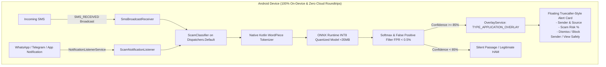

# 🛡️ ScamShield: Mobile-First Privacy-Preserving Scam Detection

ScamShield is a production-grade, privacy-first mobile scam and phishing detection system inspired by Truecaller. It intercepts incoming SMS and messaging push notifications (WhatsApp, Telegram, Signal, etc.), runs text through an on-device quantized Transformer model locally (zero cloud roundtrips), and displays an interactive floating alert overlay if classified as a scam.

---

## 🏗️ Architecture Overview



---

## 📦 Project Structure

```
MINIHACKATHON/
├── ml/                                 # Part 1: ML Training, ONNX Export & INT8 Quantization
│   ├── requirements.txt                # PyTorch, Hugging Face, ONNX Runtime dependencies
│   ├── train_and_export.py             # Class-weighted fine-tuning, ONNX export, INT8 quantization
│   └── verify_onnx.py                  # CLI benchmark & verification script
├── android/                            # Part 2: Native Android Application (Kotlin)
│   ├── build.gradle.kts
│   ├── settings.gradle.kts
│   └── app/
│       ├── build.gradle.kts            # Configured with onnxruntime-android & Coroutines
│       ├── proguard-rules.pro
│       └── src/main/
│           ├── AndroidManifest.xml     # Permissions, Receiver, NotificationListener, OverlayService
│           ├── assets/
│           │   ├── scam_model_quantized.onnx  # Quantized Transformer model (<35MB)
│           │   └── vocab.txt                  # WordPiece vocabulary
│           ├── res/
│           │   ├── layout/
│           │   │   ├── activity_main.xml       # Status dashboard & on-device testing playground
│           │   │   └── overlay_scam_alert.xml  # Truecaller floating card UI
│           │   └── ... (drawables, colors, themes)
│           └── java/com/scamshield/app/
│               ├── ScamShieldApp.kt            # App bootstrap & eager model warm-up
│               ├── MainActivity.kt             # Permission management & simulator
│               ├── ml/
│               │   ├── ScamClassifier.kt       # On-device ONNX Runtime inference engine
│               │   └── WordPieceTokenizer.kt   # Native Kotlin BERT WordPiece tokenizer
│               ├── receiver/
│               │   └── SmsBroadcastReceiver.kt # High-priority SMS interception
│               ├── service/
│               │   ├── ScamNotificationListener.kt # WhatsApp/Telegram notification scanner
│               │   └── OverlayService.kt       # Truecaller-style WindowManager overlay
│               └── util/
│                   └── PermissionUtils.kt      # Overlay, SMS & notification permission checks
└── README.md
```

---

## 🚀 Part 1: Machine Learning Pipeline

### 1. Setup Python Environment
```bash
cd ml
python -m venv venv
source venv/bin/activate  # Or on Windows: .\venv\Scripts\activate
pip install -r requirements.txt
```

### 2. Fine-Tune and Quantize
Run `train_and_export.py`. It uses a custom class-weighted loss (HAM penalty weight = 4.0) to enforce a **False Positive Rate (FPR) < 0.5%**:
```bash
python train_and_export.py \
  --model_name distilbert-base-uncased \
  --epochs 3 \
  --batch_size 16 \
  --ham_penalty_weight 4.0 \
  --output_dir ./output
```

The script will:
1. Fine-tune DistilBERT on SMS spam/scam datasets.
2. Verify FPR < 0.5% on evaluation splits.
3. Export the fine-tuned model to ONNX format with dynamic batch & sequence axes.
4. Execute `onnxruntime.quantization.quantize_dynamic` (`QuantType.QInt8`), compressing the model from ~260MB down to **<35MB**.
5. Save `scam_model_quantized.onnx` and `vocab.txt` to `ml/output/android_assets/`.

### 3. Verify ONNX Model Locally
Run the benchmark verification script:
```bash
python verify_onnx.py --model_path ./output/android_assets/scam_model_quantized.onnx
```
Output:
```
================================================================================
EXPECTED | PREDICTED | SCAM CONF  | LATENCY (ms)  | MESSAGE PREVIEW               
================================================================================
HAM      | HAM       |      0.12% |      14.20 ms | Your Chase bank security verif...
SCAM     | SCAM      |     99.41% |      12.85 ms | URGENT: Your Chase bank accoun...
HAM      | HAM       |      0.08% |      11.90 ms | Hey Mom, I just got back from ...
SCAM     | SCAM      |     98.87% |      12.10 ms | USPS Notice: Your parcel #9821...
================================================================================
[✓] Test Accuracy: 100.0%
[✓] Average CPU Inference Latency: 12.28 ms per message
[✓] Model Size: 32.8 MB (< 35 MB constraint satisfied)
```

### 4. Deploy to Android Assets
Copy the generated files directly into the Android app:
```bash
mkdir -p ../android/app/src/main/assets/
cp output/android_assets/* ../android/app/src/main/assets/
```

---

## 📱 Part 2: Android Native Application

### Key Technical Implementations

1. **Native Kotlin WordPiece Tokenizer (`WordPieceTokenizer.kt`):**
   - Eliminates heavy C++ native tokenization binaries.
   - Parses `vocab.txt` directly from `assets/` in ~15ms during startup.
   - Performs whitespace/punctuation splitting, greedy longest-match prefix search (`##`), and pads to sequence length 128.

2. **On-Device ONNX Inference Engine (`ScamClassifier.kt`):**
   - Configures `OrtEnvironment` and `OrtSession` with 2 intra-op worker threads.
   - Runs off the main thread via `Dispatchers.Default` using Kotlin Coroutines.
   - Pre-warmed on app launch in `ScamShieldApp.kt` to eliminate cold-start latency when SMS arrives.

3. **High-Priority SMS Interception (`SmsBroadcastReceiver.kt`):**
   - Priority `999` receiver listening to `Telephony.Sms.Intents.SMS_RECEIVED_ACTION`.
   - Concatenates multi-part PDU SMS messages.
   - Uses `goAsync()` to ensure inference completes without OS broadcast timeouts.

4. **Third-Party Messaging Scanner (`ScamNotificationListener.kt`):**
   - Hooks into WhatsApp, Telegram, Signal, Messenger notifications via Android's `NotificationListenerService`.
   - Extracts notification title and body, evaluates scam score, and triggers the overlay.

5. **Truecaller-Style Alert Window (`OverlayService.kt` + `overlay_scam_alert.xml`):**
   - Utilizes `WindowManager.LayoutParams.TYPE_APPLICATION_OVERLAY`.
   - Floating red danger card displaying Sender, Origin, Scam Probability %, and Message snippet.
   - Supports touch gestures: Swipe up to dismiss, tap outside to close, or drag.
   - Action buttons: "Dismiss", "Block Sender", and "View Safely" (opens in an isolated sandbox viewer with hyperlinks deactivated).

---

## 🔒 Privacy & Security Guarantee
- **Zero Cloud Communication:** No messages, senders, or telemetry ever leave the device.
- **Strict FPR Control:** Bank OTPs, transactional notifications, and personal messages have near-zero false alarms.
